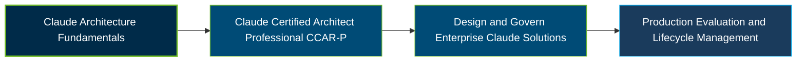

# Anthropic Claude Certified Architect – Professional Certification Exam Guide

A dedicated study guide and technical reference repository for candidates preparing for the **Anthropic Claude Certified Architect – Professional (CCAR-P) Certification Exam**, covering enterprise Claude architecture, integration, evaluation, and responsible AI delivery.

---

## Exam Overview

The Claude Certified Architect – Professional certification validates the ability to design, integrate, govern, and deliver production-grade Claude solutions across enterprise environments.

- **Exam Format**: Proctored multiple-choice and multiple-response examination through Pearson VUE, online or at a test center.
- **Target Audience**: Solution architects, AI/ML engineers, technical leads, and senior software engineers responsible for production AI solutions.
- **Prerequisites**: No formal prerequisite certification or course is required. Registration is limited to members of organizations in the Claude Partner Network.

---

## Core Exam Domains & Knowledge Areas

### 1. Solution Design & Architecture

- Translate business problems into Claude-based AI solutions.
- Design end-to-end architectures and select appropriate solution patterns.
- Plan agentic workflows, system decomposition, and business-value alignment.

### 2. Claude Models, Prompting & Context Engineering

- Select Claude models based on capability, cost, and latency trade-offs.
- Design prompts, system instructions, and context strategies.
- Manage context windows, caching, and structured model interactions.

### 3. Integration

- Integrate Claude with APIs, enterprise systems, and external tools.
- Design Model Context Protocol (MCP) and agent-based integrations.
- Plan authentication, data flows, and reliable deployment connections.

### 4. Evaluation, Testing & Optimization

- Design evaluation strategies, test datasets, and quality metrics.
- Diagnose model and workflow failures through testing and observability.
- Optimize performance, latency, reliability, and operational cost.

### 5. Governance, Safety & Risk Management

- Apply security, privacy, and responsible AI governance practices.
- Assess risks including prompt injection, misuse, and unsafe outputs.
- Design guardrails, human oversight, and compliance controls.

### 6. Stakeholder Communication & Lifecycle Management

- Translate technical architecture decisions for business stakeholders.
- Manage requirements, expectations, delivery planning, and feedback.
- Support deployment, monitoring, iteration, and solution lifecycle decisions.

### 7. Developer Productivity & Operational Enablement

- Use Claude Code and related tools to support development workflows.
- Establish team practices, shared configurations, and operational processes.
- Improve developer enablement, documentation, and ongoing support.

---

## Certification Path

---

## Recommended Practice & Study Resources

Combine official Anthropic certification training with technical documentation and practical enterprise architecture study.

- **CertsGate**: Explore [CCAR-P certification preparation resources](https://certsgate.com/exams/anthropic/ccar-p), including supplementary practice questions and study materials.
- **Anthropic Documentation & MCP**: Study the [Claude documentation](https://docs.anthropic.com/) and [Model Context Protocol documentation](https://modelcontextprotocol.io/) to explore integrations, architecture patterns, evaluation, and production workflows.
